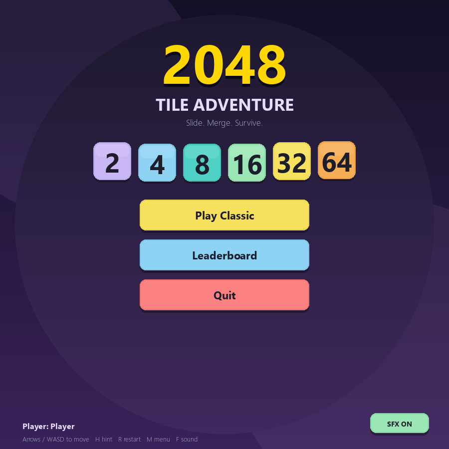
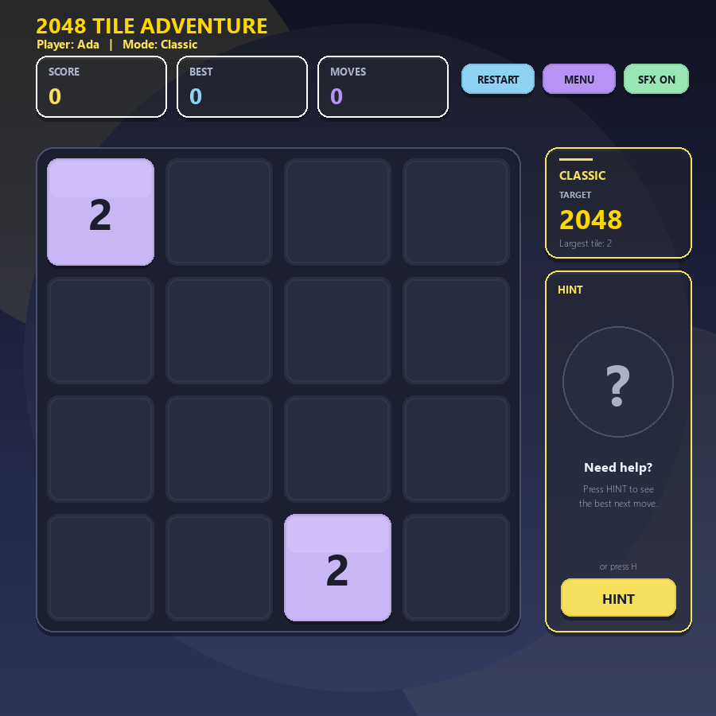

# 2048 Tile Adventure

A complete desktop 2048 game built with **Python 3** and **Pygame**, with three
modes, a robot AI companion, animations, synthesised sound effects,
achievements, milestones and local leaderboards.

The game rules live in a reusable, pure-Python `core/` package that never
imports Pygame and never reads the clock. The Pygame layer only draws screens,
collects input and reacts to events returned by the core.



---

## Contents

- [Features](#features)
- [Requirements and installation](#requirements-and-installation)
- [Running the game](#running-the-game)
- [Controls](#controls)
- [Game modes](#game-modes)
- [Project structure](#project-structure)
- [Architecture](#architecture)
- [Pseudocode map](#pseudocode-map)
- [Save data](#save-data)
- [Tests and verification](#tests-and-verification)
- [Implementation decisions](#implementation-decisions)
- [Known limitations](#known-limitations)
- [Viva notes](#viva-notes)

---

## Features

- **Classic mode** - the standard 2048 rules: slide, merge equal tiles, reach
  2048.
- **Survival mode** - a 60-second round. Every 10 seconds a random row or
  column freezes for 3 seconds; frozen cells act as walls and never receive a
  spawned tile.
- **Infection mode** - one tile starts infected. Infection spreads to adjacent
  occupied tiles every 3 successful moves. Merging one infected tile with one
  clean tile keeps the infection; merging two infected tiles cures it. The
  round ends when every occupied tile is infected.
- **Win prompt** - reaching 2048 pauses the game and offers **Keep Playing** or
  **End Game**.
- **Game-over screen** - final score, reason, and **Replay / Main Menu /
  Leaderboard** buttons.
- **Robot companion** - its colour changes with the score. Click it three
  times to make the heuristic AI solver play one move.
- **Animations** - sliding tiles, merge pops, spawn scaling, infection rings,
  block warnings, score interpolation, achievement toasts and screen fades.
- **Synthesised audio** - nine WAV effects are generated with the standard
  library on first run. The game keeps working silently if no audio device is
  available.
- **Achievements and milestones** - five achievements and five score
  milestones, persisted in the local JSON save file.
- **Local leaderboards** - top 10 records for each mode, plus lifetime stats.
- **Headless-safe design** - the whole game can run with SDL's dummy drivers
  for automated smoke testing.



---

## Requirements and installation

- Python **3.10 or newer** (developed and tested on Python 3.13.15)
- `pygame` 2.5+ (`pygame-ce` 2.5.8 is also supported and imports as `pygame`)
- Everything else is from the Python standard library:
  `json`, `random`, `time`, `datetime`, `copy`, `os`, `wave`, `struct`, `math`

Install the runtime dependency:

```powershell
python -m pip install -r requirements.txt
```

Optional, for the unit tests:

```powershell
python -m pip install pytest
```

---

## Running the game

From this folder (`tile_adventure_2048/`):

```powershell
python main.py
```

Alternative entry point:

```powershell
python -m ui.app
```

Run the unit tests:

```powershell
python -m pytest
```

Run the headless UI smoke test (saves 20 screenshots):

```powershell
python smoke_test.py
```

The smoke test uses `SDL_VIDEODRIVER=dummy` and `SDL_AUDIODRIVER=dummy`, so it
does not open a window or require a sound card.

---

## Controls

| Input | Action |
| --- | --- |
| Arrow keys or `W` `A` `S` `D` | Move tiles (up / left / down / right) |
| Mouse | Click menu buttons, tabs, HUD buttons and the robot |
| `R` | Restart the current round |
| `M` or `Esc` | Return to the main menu |
| `S` | Move tiles down (WASD) |
| `F` | Toggle sound effects |
| `K` or `Enter` | Keep playing (win prompt) |
| `E` | End game (win prompt) |
| `L` | Open the leaderboard from the game-over screen |
| `1` ... `6` | Main-menu shortcuts |
| `1` / `2` / `3`, `←` / `→` | Leaderboard mode tabs |
| `Enter` | Start the game from the name screen |
| `Backspace` | Delete a character on the name screen |

On the main menu, `Q` quits.

---

## Game modes

### Classic

The familiar 4×4 2048 board. Every successful move spawns one new tile
(90% chance of a 2, 10% chance of a 4). Reaching 2048 opens the win prompt; the
player may continue for a higher score.

### Survival

- The round lasts **60 seconds**.
- The first block starts after **10 seconds**, then every **10 seconds**.
- A block freezes one random row or column for **3 seconds**.
- With `BLOCK_FREEZES_TILES = True` (the default and the documented setting),
  frozen cells act as walls: tiles inside them cannot move or merge, and new
  tiles never spawn there.
- Existing tiles are never erased by a block.
- The clock pauses while a win prompt or the game-over screen is open.

### Infection

- The game starts with exactly one infected occupied tile.
- Infection spreads after every **3 successful moves**, to direct neighbours
  that contain a tile.
- Markers travel with their tile through slides and merges.
- Merge rule: **exactly one infected source → infected**, **both infected →
  cured**, **neither infected → clean** (an exclusive-OR).
- If every occupied tile becomes infected, the round ends.


---

## Project structure

```text
tile_adventure_2048/
├── main.py                     # Program entry point
├── requirements.txt            # pygame runtime dependency
├── pytest.ini                  # pytest configuration
├── smoke_test.py               # Headless end-to-end UI smoke test
├── leaderboard.json            # Local save file (created/updated at runtime)
├── README.md
│
├── core/                       # Pure Python: no Pygame, no clock reads
│   ├── __init__.py
│   ├── constants.py            # Board, mode, colour, achievement constants
│   ├── events.py               # GameEvent objects returned to any UI
│   ├── game_state.py           # GameState dataclass
│   ├── board.py                # Merging, moving, spawning, move_tiles
│   ├── game_flow.py            # Initialise, restart, score, status, win choice
│   ├── achievements.py         # Achievements, milestones, progress
│   ├── leaderboard.py          # JSON save/load, best scores, lifetime stats
│   ├── robot.py                # Robot colour tiers and three-click solver
│   ├── ai_solver.py            # One-ply heuristic AI
│   └── modes/
│       ├── __init__.py
│       ├── survival.py         # Survival clock and temporary blocks
│       └── infection.py        # Spread, merge rule, all-infected check
│
├── ui/                         # Pygame front-end
│   ├── __init__.py
│   ├── app.py                  # GameApp, input routing, main_game_loop
│   ├── menu.py                 # Main menu and player-name screen
│   ├── screens.py              # Leaderboards, achievements, win/game-over
│   ├── renderer.py             # Palette, fonts, board and HUD drawing
│   ├── robot_view.py           # Robot drawing, bubble and click dots
│   ├── animations.py           # Slide/pop/spawn state and toasts
│   └── sound.py                # WAV synthesis and SoundManager
│
├── tests/                      # 91 unit tests for the core
│   ├── test_board.py
│   ├── test_flow.py
│   ├── test_modes.py
│   └── test_meta.py
│
├── assets/sounds/              # Generated WAV effects (first run)
└── smoke_screenshots/          # Screenshots produced by smoke_test.py
```

---

## Architecture

### Core / UI separation

The `core/` package contains **all game rules** and is intentionally reusable:

- It never imports Pygame (verified with a case-insensitive search).
- It never calls `time.time()` or reads a clock. Functions that need time take
  a `now` argument in game seconds.
- It never draws, plays audio or opens a window.
- It returns `GameEvent` objects describing what happened.
- Randomness is injectable through an optional `random.Random` instance, so
  every test and smoke run is reproducible.

`ui/app.py` is the only place that connects both worlds:

1. It supplies `game_time` to Survival and to `move_tiles`.
2. It converts `MOVED` / `MERGED` / `SPAWNED` events into animations and sounds.
3. It converts `ACHIEVEMENT_UNLOCKED` / `MILESTONE_REACHED` into toasts.
4. It opens the win prompt on `WON` and the game-over overlay on `GAME_OVER`.

### Time model

- `ui_time` always advances. It drives hover effects, tile animations, the
  robot bob and screen fades.
- `game_time` advances only while a round is playable. It pauses for the win
  prompt and game over, which makes Survival fair.
- The core receives `game_time`; it never reads a clock itself.

### Event flow for one move

```text
key press
  -> GameApp._request_move(direction)
  -> core.board.move_tiles(state, direction, rng, now)
       -> merge/move engine
       -> spawn one tile
       -> mode update (Survival block / Infection spread)
       -> achievements and milestones
       -> win / game-over status
  -> list[GameEvent]
  -> GameApp._process_events(...)
       -> animation manager, sound manager, toasts, overlays
```

### Animation model

`core.board.move_tiles` records a `MoveResult` (source/destination cells,
merge cells, infection flags) and a `SpawnResult` in the state. The UI stores
those snapshots in `AnimationManager` with timestamps and interpolates tile
positions and scales. Animations never change the board.

### Score safety

`state.score_saved` guarantees that a round is written to the leaderboard at
most once, even though Survival timeout, Infection all-infected and
`check_game_status` can all detect the end of a round.

---

## Pseudocode map

| Pseudocode function / feature | Implementation |
| --- | --- |
| `enter_player_name` | `ui/menu.py` (screen) + `core/game_flow.clean_player_name` |
| `initialize_game` | `core/game_flow.initialize_game` |
| `show_main_menu` | `ui/menu.show_main_menu` |
| `start_new_game` | `core/game_flow.start_new_game` |
| `move_tiles` | `core/board.move_tiles` |
| `merge_row_left` | `core/board.merge_row_left` (and `_detailed`) |
| `handle_tile_merge` | `core/board.handle_tile_merge` |
| `spawn_new_tile` | `core/board.spawn_new_tile` / `spawn_tile_in_state` |
| `update_score` | `core/game_flow.update_score` |
| `save_score` | `core/leaderboard.save_score` |
| `load_local_leaderboards` | `core/leaderboard.load_local_leaderboards` |
| `display_leaderboards` | `ui/screens.display_leaderboards` |
| `update_robot_color` | `core/robot.update_robot_color` |
| `handle_robot_click` | `core/robot.handle_robot_click` |
| `run_ai_solver` | `core/ai_solver.run_ai_solver` |
| Survival clock / block functions | `core/modes/survival.py` |
| Infection functions | `core/modes/infection.py` |
| `get_tile_color` | `core/constants.get_tile_color` (name) + `ui/renderer.get_tile_color` (RGB) |
| Animations and sounds | `ui/animations.py`, `ui/sound.py`, `ui/app.py` |
| Achievements / milestones | `core/achievements.py`, `ui/screens.display_achievements` |
| `main_game_loop` | `ui/app.main_game_loop` / `GameApp.run` |
| `check_game_status` | `core/game_flow.check_game_status` |

---

## Save data

The game writes `leaderboard.json` next to the project files. It is created
automatically and is safe to delete. A clean file looks like this:

```json
{
  "leaderboards": {
    "Classic": [],
    "Survival": [],
    "Infection": []
  },
  "best_scores": {
    "Classic": 0,
    "Survival": 0,
    "Infection": 0
  },
  "achievements": [],
  "stats": {
    "games_played": 0,
    "total_score": 0,
    "total_merges": 0,
    "largest_tile": 0
  }
}
```

- Each leaderboard keeps the best **10** records, highest score first.
- Achievements are lifetime unlocks and survive restarts.
- `stats` powers the four cards on the Achievements screen.
- A missing or damaged file falls back to an empty structure instead of
  crashing.
- Tests and the smoke test pass an explicit temporary `data_path`, so they
  never touch the real save file.

---

## Tests and verification

### Unit tests

```text
$ python -m pytest
92 passed
```

The 92 tests cover:

- merging in all four directions, double-merge prevention, spawn chances,
  invalid moves and infection markers travelling with tiles;
- player-name rules, initial boards, restart reset behaviour, score updates,
  win prompt resolution, no-move game over and single score saves;
- Survival clock/block expiry, infection spread/merge XOR/all-infected;
- achievement and milestone unlocking, progress bars, leaderboard sorting and
  limits, robot colour tiers, three-click solver and AI heuristics;
- a purity test that scans `core/` for Pygame, `time` and `datetime` imports.

### Core purity check

```powershell
Select-String -Path core\*.py,core\modes\*.py -Pattern 'pygame' -CaseSensitive:$false
```

returns no matches.

### Headless UI smoke test

```text
$ python smoke_test.py
All smoke checks passed.
Saved records: {'Classic': 1, 'Survival': 1, 'Infection': 1}
Lifetime stats: {'games_played': 3, 'total_score': 2052, 'total_merges': 2, 'largest_tile': 2048}
```

The smoke test exercises all six menu options, name entry, all three modes,
HUD Restart / Menu / Sound, the robot's three-click AI hint, both win choices,
the game-over screen and its three buttons, every leaderboard tab, and the
achievements screen. It writes 20 screenshots to `smoke_screenshots/`.

---

## Implementation decisions

These are the places where the written pseudocode allowed more than one
reasonable interpretation.

1. **`merge_row_left` returns only the merged row.** The extra data needed by
   the UI (score, merge positions, infection flags, source cells) comes from
   `merge_row_left_detailed`. This keeps the documented function signature
   simple while still supporting animations.

2. **Infection merge is an exclusive-OR.** One infected source keeps the
   infection; two infected sources cure it. This is implemented once in
   `core/modes/infection.transfer_infection_on_merge` and called by the merge
   engine.

3. **`BLOCK_FREEZES_TILES = True`.** A Survival block is a real wall. Tiles
   inside the frozen row/column cannot move or merge, and the board engine
   splits a line into independent segments around the block. The constant is
   documented in `core/constants.py`; setting it to `False` would make blocks
   only prevent new spawns.

4. **Blocks never receive spawned tiles.** `spawn_new_tile` excludes blocked
   cells explicitly, even when `BLOCK_FREEZES_TILES` is `False`.

5. **The win prompt is an event, not an input prompt inside the core.**
   `check_game_status` returns a `WON` event and sets `win_prompt_pending`. The
   Pygame UI shows the overlay and later calls `resolve_win_choice`. This keeps
   the core usable from a web UI.

6. **Achievements are session-persistent; milestones are per-game.**
   `start_new_game` keeps `state.achievements` but clears `state.milestones`.
   Lifetime achievements are also stored in `leaderboard.json`. Creating a
   completely new state from the main menu starts a new session list, but the
   saved lifetime unlocks still appear on the Achievements screen.

7. **The Survival clock pauses during overlays.** `game_time` is frozen while
   the win prompt or game-over screen is visible, so reading the prompt does
   not consume the 60-second round.

8. **The robot's third click is deferred by the UI.** The first two clicks go
   straight to `handle_robot_click`. The third click starts a short
   "Thinking..." bubble, then forwards the real third click to the core. The
   core still sees exactly three clicks and resets its counter itself.

9. **Leaving mid-game does not create a leaderboard record.** Pressing `M`,
   `Esc` or the HUD Menu button saves best scores and achievements through
   `save_progress`, but only a real game over writes a score record. Restarting
   a round abandons it without adding an entry. This prevents abandoned rounds
   from flooding the leaderboard.

10. **Names are trimmed and capped at 12 characters.** An empty or whitespace
    name becomes `"Player"`; longer names are truncated.

11. **The AI solver is one-ply and heuristic.** It simulates all four moves with
    the same board engine and scores the resulting boards using named weights:
    empty cells `270`, merge potential `70`, corner bonus `120`, monotonicity
    `45`, smoothness `12`, largest tile `1.5`, plus a corner-loss penalty. It is
    intentionally understandable for a viva rather than unbeatable.

12. **The UI is a fixed 900×900 layout.** The board is 610×610, with score
    panels above and mode/robot/AI panels on the right. Animations use
    `ui_time`; Survival uses the separate `game_time`.

---

## Known limitations

- The AI solver is one move deep. It can make a locally good move that is bad
  several moves later, and it does not search game trees.
- Survival blocks can temporarily make some moves impossible, especially on a
  crowded board. This is intentional (`BLOCK_FREEZES_TILES = True`) but can feel
  harsh.
- Leaderboards are local JSON only; there is no online sync or account system.
- There is no undo, redo, pause menu or settings screen beyond the sound toggle.
- The window is fixed at 900×900 and does not scale to other resolutions.
- Sound effects are short synthesised tones, not music. Audio is skipped
  silently when no device is available.
- Session achievements are reset when a brand-new `GameState` is created from
  the main menu; lifetime achievements remain saved.
- UI behaviour is verified by a headless smoke test and screenshots, not by
  pixel-perfect visual regression tests.

---

## Viva notes

Useful points to explain:

- **Why the core has no Pygame:** the same rules can power a web UI, and the
  rules are testable without a display. The only imports in `core/` are Python
  standard-library modules and other core modules.
- **Why `now` is passed in:** it removes hidden clock reads, makes Survival
  deterministic in tests, and lets the UI pause the game during overlays.
- **How infection travels:** `apply_move_to_grid` builds a parallel boolean
  grid for infection flags, merges it with the numeric grid, then rebuilds
  `state.infected_tiles` from occupied cells only.
- **Why `score_saved` exists:** three different code paths can detect the end
  of a round; the flag makes saving idempotent.
- **How animations stay correct:** the core commits the final board
  immediately, but also returns source/destination cells. The UI draws the old
  tiles moving towards their new cells, then draws the final board with merge
  pops and spawn scaling.
- **How the robot works:** colour tiers are score thresholds; three clicks
  trigger a one-ply heuristic solver that performs a normal move through
  `move_tiles`, so it gets the same spawn, achievement and status handling as a
  human move.
- **How achievements are stored:** the session list is in `GameState`, while
  lifetime unlocks and statistics are merged into `leaderboard.json`.
